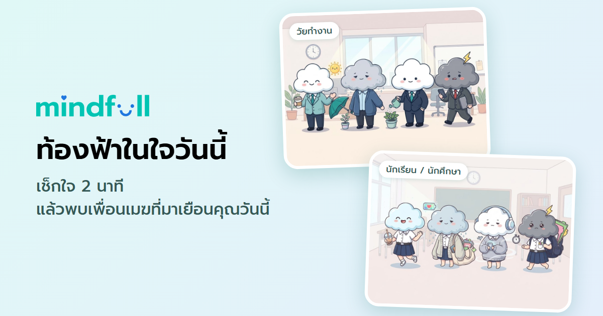

# mindfull

[](https://mindfull-prototype.vercel.app)

Mobile-first 2-minute mental-health check-in for Thai office workers and students (pick one on the first screen). Answer 6 illustrated scenarios, meet the cloud friend visiting today (Cumulo, Nimbo, Strato or Humi), pick one way to care for yourself (now / tonight / this week), and get a right-sized next step into the consultation app.

**Live:** https://mindfull-prototype.vercel.app

Built on the mindfull design system: colours come from its tokens, type is Prompt on its Thai scale, and the illustrations are full-width pictures under an overlapping card.

## Run locally

No build step and no dependencies. Serve the `prototype/` folder:

```bash
npx serve prototype
```

Then open the printed URL. Test at 390×844 first, then desktop.

After changing the characters, rebuild the link-preview image (needs Edge or Chrome):

```bash
node scripts/build-og-image.mjs
```

## Deploy (Vercel)

| Setting | Value |
| --- | --- |
| Framework Preset | Other |
| Root Directory | `prototype` |
| Build Command | (none) |
| Output Directory | (leave empty) |

`index.html` sets `noindex` so the site stays out of search results.

## Files

| Path | What |
| --- | --- |
| `prototype/index.html` | Markup and stage containers |
| `prototype/styles.css` | Semantic tokens, layout, responsive rules |
| `prototype/content.js` | All copy, scoring axes, picture alt texts |
| `prototype/app.js` | State, scoring, screens, micro-actions, share |
| `prototype/assets/work/`, `prototype/assets/student/` | One folder per group. `scenes/`: question pictures `q1`–`q6.jpg` and the last-screen picture `sentnoti.jpg`. `characters/`: one picture per character (lowercase name) and the landing picture `all.jpg` |
| `prototype/assets/logo/mindfull-tokens.css` | Copy of the design-system `:root` tokens |
| `prototype/assets/logo/mindfull-logo.svg` | mindfull wordmark (use as supplied, never recolor) |
| `prototype/og-image.png` | Link-preview image (1200×630); rebuild with `node scripts/build-og-image.mjs` |
| `docs/overview.md` | Product logic: principles, questions and their sources, results, next steps, safety, decision log |
| `docs/user-flow.md` | Screen-by-screen flow with timings |
| `docs/characters.md` | Full copy for the 4 characters |

## Not in this repo

The mindfull design-system sources (brand book PDFs, icon and mascot artwork, Gotham Rounded font files) belong to mindfull and stay outside this repo. Gotham Rounded is a commercial font that needs a web licence, so this build uses Prompt only.
