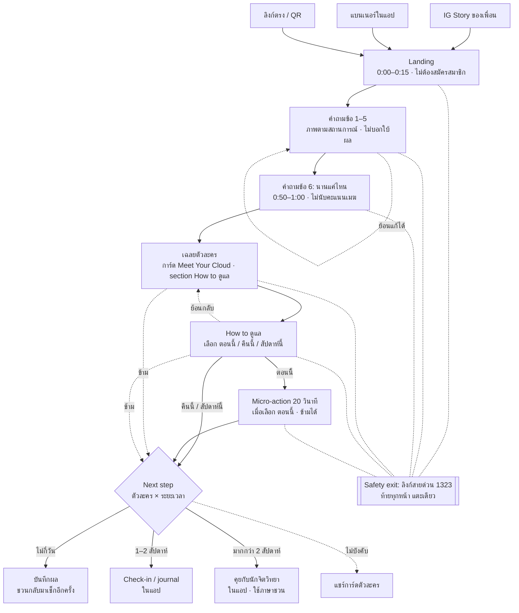

# User Flow: 2 นาทีของแพร

แพรผ่าน 7 หน้าจอเรียงต่อกันใน 2 นาที (หน้า How to ดูแล และ micro-action ข้ามได้) มีทางแยกจุดเดียวคือ next step ที่ขึ้นกับชนิดเมฆและระยะเวลา ส่วน safety exit เข้าถึงได้จากทุกหน้า

## Flow ภาพรวม

Humi ได้ข้อเสนอแบบเบาเสมอ ส่วนเมฆอื่นดูที่ระยะเวลา รายละเอียดอยู่ใน next-step matrix ของ `overview.md`

## รายละเอียดรายหน้าจอ

| # | หน้าจอ | เวลา (เป้า) | เนื้อหาหลัก | Interaction | หมายเหตุ |
| --- | --- | --- | --- | --- | --- |
| 1 | Landing | 0:00–0:15 | "วันนี้ท้องฟ้าในใจคุณเป็นยังไงบ้าง?" ใช้แค่ 2 นาที ไม่ต้องสมัคร ไม่เก็บคำตอบ disclaimer | ภาพเพื่อนเมฆ 4 ตัว ป้าย "เพื่อนเมฆรออยู่ เฉลยตอนจบนะ" กด "ไปดูน้องก้อนเมฆกัน" ปุ่มเดียว | – |
| 2 | คำถามข้อ 1–5 | 0:15–0:50 | สถานการณ์งานพร้อมภาพประกอบ กรอบเวลา "ช่วงนี้ ถ้าเจอแบบนี้ คุณน่าจะ…" 4 ตัวเลือกสลับลำดับ | แตะเลือกแล้วไปข้อถัดไป ข้อ 1 มีปุ่ม "กลับหน้าแรก" ข้อ 2 ขึ้นไปมี "ข้อก่อนหน้า" | ไม่บอกใบ้ผล พื้นหลังเป็น `gray-50` ตลอด |
| 3 | คำถามข้อ 6 | 0:50–1:00 | "ถ้าช่วงนี้คุณรู้สึกเหนื่อยหรือหนักใจเรื่องงาน ความรู้สึกนี้อยู่กับคุณมานานแค่ไหนแล้ว?" | แตะเลือก 1 ใน 4 ตัวนับแสดง "ข้อสุดท้าย" | ไม่เปลี่ยนตัวละคร ใช้กับ next step |
| 4 | เฉลยตัวละคร | 1:00–1:35 | การ์ดเปิดด้วย "นี่คือใจคุณช่วงนี้ เมฆลอยผ่านไปได้ พรุ่งนี้อาจเป็นเมฆตัวอื่น": รู้จัก, พับ "รู้จัก [ชื่อ] ให้มากขึ้น" (พลังพิเศษ, ข้อดี, เมื่อพลังล้น, เพื่อนซี้), How to ดูแล (คำอธิบายสั้น + ปุ่มหลัก), reframe | ภาพเปลี่ยนเป็นตัวละครที่มาเยือน กด "ลองทำดู" ใน section How to ดูแล ส่งการ์ดให้เพื่อน หรือข้ามไปก้าวต่อไป | อ่านครบราว 35–50 วินาที ต้องจับเวลาจริง |
| 5 | How to ดูแล | 1:35–1:40 | "เลือกหนึ่งอย่างที่คุณจะลอง" ตอนนี้ / คืนนี้ / สัปดาห์นี้ | เลือก 1 ใน 3: ตอนนี้ → เริ่มเลย 20 วินาที, คืนนี้/สัปดาห์นี้ → บันทึกคำสัญญา ตั้งเตือนได้ แล้วไปก้าวต่อไป | ย้อนกลับไปการ์ดได้ ข้ามได้ |
| 6 | Micro-action | 1:40–2:00 | กิจกรรม 20 วินาทีตามตัวละคร (เมื่อเลือก "ตอนนี้") | หายใจ / วางลง / grounding / จด | ข้ามได้ |
| 7 | Next step | 2:00+ | ภาพคนหัวเมฆยืนถือโทรศัพท์มีแจ้งเตือน (ไปต่อในแอป) · "สรุปใจคุณวันนี้": การ์ดใบเดียว มีเมฆที่มาเยือน, สิ่งที่จะลอง (ถ้าเลือก) และก้าวต่อไปตามตัวละคร × ระยะเวลา | ปุ่มหลัก, ส่งการ์ดให้เพื่อน, เล่นอีกครั้ง | ไม่มีหน้าจองหรือราคา |
| 8 | การ์ดแชร์ | ไม่บังคับ | ตัวละคร, ฉายา, พลังพิเศษ, รู้ไหม | แชร์หรือคัดลอกข้อความ | ไม่มีข้อมูลส่วนตัว |

### ภาพประกอบหน้าคำถาม

| ข้อ | ภาพ |
| --- | --- |
| 1 | นั่งหน้าแล็ปท็อป อีเมลแจ้งเตือน 40 ฉบับ ป้าย "จันทร์" |
| 2 | ถือโทรศัพท์ตอนกลางคืน 20:00 ข้อความจากหัวหน้า |
| 3 | พักเที่ยง ชามอาหาร นาฬิกาเที่ยงตรง |
| 4 | ข้อความเพื่อน "ไปเที่ยวเสาร์นี้ไหม" กระเป๋า ภูเขา |
| 5 | นอนห่มผ้าคืนวันอาทิตย์ พระจันทร์ |
| 6 | ปฏิทินที่ระบายสีหลายวัน |

**Safety exit ทุกหน้า:** มีลิงก์ท้ายจอ "ถ้าหนักเกินไหว คุยกับสายด่วนสุขภาพจิต 1323" ที่พาไปสายด่วนสุขภาพจิต 1323 ได้ในหนึ่งแตะ

## หน้าแรกและการเลือกชุดคำถาม (v3.7)

ลำดับบนหน้า: โลโก้ mindfull → "เช็กอินใจ · ใช้เวลาประมาณ 2 นาที" → หัวข้อบรรทัดเดียว "วันนี้ใจคุณเป็นแบบไหน?" → คำอธิบายสั้น → แบนเนอร์คำแนะนำ "เลือกชุดคำถามให้ตรงกับชีวิตช่วงนี้" → "คุณอยู่ในช่วงไหน?" → การ์ดเลือก 2 ใบ (วัยทำงาน, นักเรียน / นักศึกษา) แต่ละใบมีภาพรวมตัวละครของชุดนั้นเป็นแบนเนอร์ มีป้ายหัวข้อย่อยบนภาพ (เรื่องงาน · เดดไลน์ · หัวหน้า · เวลาพัก / เรื่องเรียน · สอบ · เกรด · งานกลุ่ม) ชื่อกลุ่ม รายละเอียดสั้นๆ ("สำหรับคนที่กำลังทำงาน สถานการณ์มาจากชีวิตในที่ทำงานและหลังเลิกงาน" / "สำหรับคนที่กำลังเรียน สถานการณ์มาจากชีวิตในห้องเรียนและเวลาหลังเลิกเรียน") และปุ่ม "เริ่มเช็กใจเลย" → ข้อความท้ายหน้า "ไม่ต้องสมัคร · ไม่เก็บคำตอบ · ไม่ใช่การวินิจฉัย" และลิงก์สายด่วน 1323 ตัวละครปรากฏบนหน้าแรกเฉพาะในแบนเนอร์ของการ์ด

การกดปุ่มในการ์ดคือการเริ่มเล่น จึงไม่เพิ่มขั้นตอนและไม่กระทบงบเวลา 2 นาที ชุดที่เลือกกำหนดภาพประกอบ ชุดคำถาม (ข้อ 1–5 และข้อ 6) และ copy ของผลลัพธ์ ส่วนการคิดคะแนน กติกา 2 สัปดาห์ และ next step ใช้ร่วมกัน การ์ดเรียงแนวตั้งบนมือถือ และเรียงข้างกันเมื่อจอกว้างตั้งแต่ 720px

โฟลเดอร์รูป: `assets/work/` และ `assets/student/` แต่ละโฟลเดอร์มี `scenes/` (`q1`–`q6.jpg`, `sentnoti.jpg` หน้าสุดท้าย) และ `characters/` (`cumulo`, `nimbo`, `strato`, `humi`, `all` ภาพรวมที่ใช้เป็นแบนเนอร์การ์ดหน้าแรก) ส่วนโลโก้อยู่ใน `assets/logo/`

## หน้าคำถาม–คำตอบ (v3.8)

ข้อความคำถาม ตัวเลือก ลำดับ การสุ่ม และพฤติกรรมการตอบไม่เปลี่ยน ปรับเฉพาะหน้าตา ลำดับบนหน้า: ภาพสถานการณ์เต็มความกว้างบนสุด (วัยทำงานใช้ `assets/work/scenes/`, นักเรียน / นักศึกษาใช้ `assets/student/scenes/`) โดยแผ่นเนื้อหาสีขาวซ้อนขึ้นมาทับขอบล่างของภาพ → ปุ่ม "กลับหน้าแรก" (ข้อแรก) หรือ "ข้อก่อนหน้า" ทางซ้าย และป้ายกลุ่มทางขวา → "คำถามที่ n / 6" พร้อมแถบความคืบหน้า (ใช้กับทุกข้อรวมข้อ 6) → คำถาม ชิดซ้าย (ข้อ 1–5 มีบรรทัด "ช่วงนี้ ถ้าเจอแบบนี้ คุณน่าจะ…" ใต้คำถาม) → การ์ดคำตอบแตะได้ทั้งใบ มีวงกลมสถานะอยู่ด้านหน้าข้อความเต็ม (เลือกแล้วขอบ พื้น และวงกลมเปลี่ยนสี มีเครื่องหมายถูก) แล้วไปข้อต่อไปเอง → ท้ายหน้ามีโลโก้เล็กและ "เป็นแค่การเช็กความรู้สึก ไม่ใช่การวินิจฉัยนะ" ไม่มีป้ายลำดับ "สถานการณ์ที่ n" เลขหน้าตัวเลือก และบรรทัดคำแนะนำ (ถูกตัดออกตามการตัดสินใจ) ความสูงของภาพปรับตามความสูงจอ (ราว 345px บน 390×844) ระยะห่างระหว่างส่วน 16px และการ์ดเว้นให้โปร่ง หน้าไม่ต้องแสดงครบในจอเดียว ให้เลื่อนดูได้ การ์ดมี focus ring และ hover โดยความหนาขอบคงที่ จึงไม่ขยับเลย์เอาต์

## หน้าผลลัพธ์ (v3.9)

ข้อความของตัวละครและผลลัพธ์ไม่เปลี่ยน (ทั้งชุดวัยทำงานและนักเรียน / นักศึกษา) ปรับเฉพาะการจัดวาง ลำดับ: ภาพตัวละครของชุดที่เลือกอยู่บนสุด กรอบสูงราว 312px ครอปบนล่าง (เหมือนเดิมของหน้า) แผ่นขาวซ้อนทับขอบล่าง และรูปเลื่อนไปพร้อมหน้าตอน scroll เหมือนหน้าถาม–ตอบ → ป้าย "ผลเช็กใจของคุณ · วันนี้" → ชื่อ → ฉายา → ประเภทเมฆ (ไทย) และชื่อชนิดเมฆทางวิทยาศาสตร์ → ประโยค "นี่คือใจคุณช่วงนี้…" → การ์ด "ภาพรวมความรู้สึก" → การ์ดเด่น "ก้าวเล็กๆ ที่เริ่มได้" พร้อมปุ่ม "เลือกวิธีดูแลใจ" ไปหน้าเลือกวิธีดูแลเดิม → ส่วนพับ "รู้จัก [ชื่อ] ให้มากขึ้น" → ประโยคปิดในกรอบแยก → "แชร์ผลลัพธ์นี้" และ "ดูก้าวต่อไป" → ส่วนท้าย การจับคู่เพื่อนซี้ไม่เปลี่ยน

## หน้า How to ดูแล (v3.10)

ข้อความวิธีดูแลและป้ายเวลาไม่เปลี่ยน (ตาม `CARE` และ `WHEN` ของชุดผู้ใช้และตัวละคร) ลำดับบนหน้า: ภาพตัวละครของชุดที่เลือกอยู่บนสุด → ปุ่ม "กลับไปดูผลลัพธ์" และป้ายกลุ่ม → "HOW TO ดูแล · [ชื่อ]" → "เลือกหนึ่งอย่างที่คุณจะลอง" → "เลือกตามเวลาและแรงที่มี ไม่จำเป็นต้องทำทุกข้อ" → การ์ด 3 ใบ (วงกลมสถานะอยู่ด้านหน้า, ป้ายเวลา "ตอนนี้ · 20 วินาที" / "คืนนี้" / "สัปดาห์นี้", ข้อความ ไม่มีเลขลำดับ) → ส่วนต่อเนื่องที่เปลี่ยนตามที่เลือก → โลโก้และข้อความไม่ใช่การวินิจฉัย

- มีลิงก์ "ไปที่ก้าวต่อไป" สำหรับคนที่ไม่อยากเลือก
- แตะการ์ดแล้วไปหน้า "วิธีดูแลใจที่คุณเลือก" ทันที (ดูส่วนถัดไป) ปุ่มทั้งหมดหลังเลือกย้ายไปอยู่หน้านั้น ข้อความในการ์ดไม่เปลี่ยนตอนเลือก

## หน้าต่างแชร์ผลลัพธ์ (v3.11)

เปิดซ้อนบนหน้าผลลัพธ์ (และจากหน้าก้าวต่อไปของเมฆฟ้าใส) เป็น dialog (`role="dialog"`, `aria-modal`, ชื่อ "วันนี้ [ชื่อ] มาเยือนฉัน") ข้อมูลทั้งหมดดึงจาก `CHAR` ของตัวละครและชุดผู้ใช้ที่ได้ ไม่มีคำตอบหรือข้อมูลส่วนตัว ลำดับในการ์ด: ภาพตัวละครเต็มความกว้าง (วัยทำงานใช้ `assets/work/characters/`, นักเรียน / นักศึกษาใช้ `assets/student/characters/`) พร้อมป้าย "การ์ดผลลัพธ์" และปุ่มปิด → โลโก้ mindfull กับชื่อ "ท้องฟ้าในใจวันนี้" → ป้าย "ผลเช็กใจของฉัน" → "วันนี้ [ชื่อ] มาเยือนฉัน" → ฉายา → การ์ด "พลังพิเศษ" (ชื่อพลังและชื่อภาษาอังกฤษ) → กล่อง "รู้ไหม" (เกร็ดวิทยาศาสตร์) → "การ์ดนี้แสดงแค่เพื่อนเมฆ ไม่มีคำตอบหรือรายละเอียดส่วนตัวของคุณ" → ปุ่มหลัก "แชร์การ์ดนี้" และปุ่มรอง "กลับไปดูผลลัพธ์"

- เปิดแล้วโฟกัสอยู่ที่ "แชร์การ์ดนี้" ปิดได้ด้วยปุ่ม X, "กลับไปดูผลลัพธ์", Esc หรือแตะพื้นหลัง แล้วโฟกัสกลับไปที่ปุ่มแชร์บนหน้าผลลัพธ์
- "แชร์การ์ดนี้" เรียกหน้าต่างแชร์ของอุปกรณ์ (`navigator.share`) ถ้าใช้ไม่ได้ก็คัดลอกข้อความ หรือแสดงข้อความแจ้งตามเดิม
- ถ้าการ์ดสูงกว่าจอ เลื่อนภายในการ์ดได้ และปุ่มทั้งสองติดอยู่ด้านล่างของการ์ดเสมอ

## หน้าวิธีดูแลใจที่เลือก (v3.12)

หน้าต่อจากการเลือกในหน้า How to ดูแล (ไม่ใช่การเลือกซ้ำ) ใช้ได้กับทุกตัวละคร ทุกชุดผู้ใช้ และทุกช่วงเวลา ข้อความวิธีดูแลมาจาก `CARE` และป้ายเวลาจาก `WHEN` เดิม ลำดับ: ภาพตัวละครบนสุด → ปุ่ม "เปลี่ยนวิธีที่เลือก" (กลับหน้า How to ดูแล โดยคงตัวเลือกเดิมไว้) และป้ายกลุ่ม → "HOW TO ดูแล · [ชื่อ]" → "วิธีดูแลใจที่คุณเลือก" → "เก็บไว้เป็นก้าวเล็กๆ ที่ทำได้ในจังหวะของคุณ" → การ์ด 01 (ป้ายเวลา, ป้าย "เลือกแล้ว", "สิ่งที่คุณจะลอง", ข้อความวิธีดูแลเต็ม) → การ์ด 02 "ขั้นต่อไป" (สีฟ้า แยกจากการ์ด 01) → ปุ่ม → โลโก้และข้อความไม่ใช่การวินิจฉัย

| เลือก | ข้อความการ์ด 02 | ปุ่มหลัก | ปุ่มรอง |
| --- | --- | --- | --- |
| ตอนนี้ · 20 วินาที | เมื่อพร้อม กดเริ่มกิจกรรมสั้นๆ ใช้เวลาประมาณ 20 วินาที | เริ่มเลย 20 วินาที (ไป micro-action ของตัวละคร) | ข้ามไปดูก้าวต่อไป |
| คืนนี้ / สัปดาห์นี้ | คุณบันทึกแผนนี้ไว้ แล้วไปดูก้าวต่อไปได้ | ไปที่ก้าวต่อไป | ตั้งเตือนในแอป (toast เดิม) |

## หน้ากิจกรรม 20 วินาที (v3.13)

กิจกรรมของทั้ง 4 ตัวละครใช้โครงหน้าเดียวกัน ข้อความ ลำดับ และพฤติกรรมเดิมทุกอย่าง ปรับเฉพาะหน้าตา ลำดับบนหน้า: ภาพตัวละครบนสุด → ปุ่ม "กลับไปที่ผลลัพธ์" และป้ายกลุ่ม → "HOW TO ดูแล · [ชื่อ]" กับป้าย "ใช้เวลา 20 วินาที" → ชื่อกิจกรรม → คำอธิบายสั้น → การ์ดกิจกรรม → ปุ่ม (ปุ่มหลักตามกิจกรรมและลิงก์ "ข้าม") → โลโก้และข้อความไม่ใช่การวินิจฉัย

| ตัวละคร | กิจกรรมในการ์ด | ปุ่มหลัก |
| --- | --- | --- |
| Cumulo | วงกลมหายใจ มีป้ายอธิบายสี (หายใจเข้า 4 วินาที = เขียวอมฟ้า, หายใจออก 6 วินาที = น้ำเงิน) วงกลมเปลี่ยนสีและขยาย/หดตามจังหวะพร้อมตัวเลขนับถอยหลังและข้อความบอกจังหวะ ตามภาพตัวละคร ทำเสร็จแล้วขึ้นเครื่องหมายถูกกลางวงกลม | เริ่มหายใจ |
| Nimbo | ช่องพิมพ์ "วันนี้ฉันจะวางเรื่องนี้ลงก่อน" กด "วางมันลง" แล้วส่วนกรอกหายไปหมด เหลือเครื่องหมายถูกในการ์ดกับปุ่ม "ไปที่ก้าวต่อไป" | วางมันลง |
| Strato | ขั้น 3-2-1 เป็นแถวมีเลข ขั้นปัจจุบันเน้นสี ขั้นที่ทำแล้วเป็นเครื่องหมายถูก | ทำแล้ว |
| Humi | ช่องพิมพ์ "สัปดาห์นี้โอเคเพราะ" (เก็บไว้ในเครื่องเหมือนเดิม) กด "เก็บไว้" แล้วส่วนกรอกหายไปหมด เหลือเครื่องหมายถูกในการ์ดกับปุ่ม "ไปที่ก้าวต่อไป" | เก็บไว้ |

เมื่อทำจบ ข้อความยืนยันขึ้นเป็นกรอบสีเขียวอมฟ้า พร้อมปุ่ม "ไปที่ก้าวต่อไป" วงกลมหายใจไม่ขยายเมื่อผู้ใช้ตั้งลดแอนิเมชัน

ปุ่ม "เปลี่ยนวิธีที่เลือก" ในหน้าวิธีดูแลใจที่เลือก ล้างตัวเลือกเดิม หน้า How to ดูแลจึงกลับมาเป็นสถานะยังไม่ได้เลือก

## หน้าสรุปใจคุณวันนี้ (v3.14)

ข้อความ ตัวละคร ปุ่ม และการทำงานไม่เปลี่ยน (ข้อความก้าวต่อไปและชื่อปุ่มหลักมาจาก `NEXT[ผลลัพธ์][ระยะเวลา]` เดิม) ปรับเฉพาะการจัดวาง ลำดับ: ภาพสรุปท้ายชุดของโปรไฟล์ (`sentnoti.jpg`) บนสุด → ปุ่ม "กลับไปที่ผลลัพธ์" และป้ายกลุ่ม → ป้าย "สรุปการเช็กอิน" → "สรุปใจคุณวันนี้" → ข้อความอธิบาย (เลือกวิธีดูแลแล้ว: "นี่คือเพื่อนเมฆที่มาเยือนและสิ่งที่คุณเลือกไว้" / ยังไม่เลือก: "นี่คือผลเช็กอินของคุณและคำแนะนำขั้นต่อไป") → การ์ดตัวละคร (ภาพเล็ก ชื่อ ฉายา และเฉพาะเมื่อเลือกไว้ ส่วน "สิ่งที่คุณเลือก" พร้อมป้ายเวลาเต็มและข้อความวิธีดูแลเต็ม) → การ์ด "ก้าวต่อไป" แยกต่างหาก (สีฟ้า) → ปุ่ม → โลโก้และข้อความไม่ใช่การวินิจฉัย

- ปุ่มหลักคือชื่อจากข้อมูลผลลัพธ์ (เช่น "เช็กใจอีกครั้งในแอป", "เขียน journal ในแอป", "เริ่ม check-in รายวัน", "คุยกับนักจิตวิทยาในแอป") ถ้าเป็น "ส่งต่อให้เพื่อน" ปุ่มหลักเปิดหน้าต่างแชร์ และไม่มีปุ่มรอง
- ปุ่มรอง "ส่งการ์ด [ชื่อ] ให้เพื่อน" แสดงเฉพาะกรณีที่ปุ่มหลักไม่ใช่การแชร์ และ "เล่นอีกครั้ง" เป็นลิงก์ท้ายสุด

## หน้าขอความยินยอมส่งข้อมูลไปที่แอป (v3.15)

เปิดจากปุ่มหลักของหน้า "สรุปใจคุณวันนี้" (เช่น "เช็กใจอีกครั้งในแอป", "เขียน journal ในแอป", "เริ่ม check-in รายวัน", "คุยกับนักจิตวิทยาในแอป") ถ้าปุ่มหลักคือ "ส่งต่อให้เพื่อน" ยังเปิดหน้าต่างแชร์เหมือนเดิม ไม่ผ่านหน้านี้

หน้ามี 3 หัวข้อ (4 หัวข้อถ้าเลือกวิธีดูแลใจไว้) แต่ละหัวข้อมีคำอธิบายสั้น ข้อมูลที่จะส่ง และตัวเลือก "ยอมรับ" / "ไม่ยอมรับ" (ไม่เลือกไว้ล่วงหน้า):

1. เมฆที่มาเยือนวันนี้ (ชื่อเพื่อนเมฆ ฉายา ประเภทเมฆ)
2. วิธีดูแลใจที่คุณเลือก (ช่วงเวลาและข้อความที่เลือก) แสดงเฉพาะเมื่อเลือกไว้
3. ระยะเวลาที่รู้สึกหนักใจ (ตัวเลือกที่ตอบในข้อ 6)
4. ใช้เพื่อก้าวต่อไปในแอป (ชื่อปุ่มหลักของผลลัพธ์นั้น)

ด้านบนมีบรรทัด "ไม่ส่ง: คำตอบรายข้อ และข้อความที่คุณพิมพ์ในกิจกรรม" ปุ่ม "ส่งข้อมูล" ต้องเลือกครบทุกหัวข้อก่อน ถ้ายังไม่ครบจะขึ้นข้อความเตือนและพาไปหัวข้อที่ยังไม่เลือก เมื่อส่งแล้วแสดงสรุปว่าหัวข้อไหนยอมรับหรือไม่ยอมรับ และบอกว่า prototype ไม่ได้ส่งข้อมูลออกจากเครื่องจริง

รูปบนสุดของหน้ายินยอม: ฟอร์ม `assets/consent/consent.jpg` (โทรศัพท์แสดงรายการที่เลือกยอมรับหรือไม่ยอมรับ พร้อมกุญแจ) และหลังกด "ส่งข้อมูล" `assets/consent/sent.jpg` (เครื่องหมายถูกพร้อมเครื่องบินกระดาษ) ใช้ร่วมกันทั้งชุดวัยทำงานและนักเรียน / นักศึกษา
